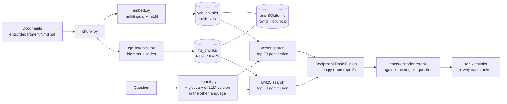

# hybrid-search-rag

[](https://github.com/wchklaus97/hybrid-search-rag/actions/workflows/tests.yml)

**Theme: hybrid search for Hong Kong code-mixed documents. Keyword search (BM25) and vector search run together in one SQLite file, query expansion bridges Chinese and English, and a multilingual cross-encoder reranks the results.**

Hong Kong business text mixes Chinese and English in the same sentence ("如懷疑資料外洩，須喺 24 小時內通知 Compliance Officer"). It is also full of codes and amounts (`FIN-07`, `HKD 5,000`, `RMB 50,000`). Vector search is good at meaning but blurs exact terms. Keyword search is exact but, out of the box, cannot see Chinese words at all. And staff ask in either language: "data breach" shares no word with 資料外洩. This repo combines the methods and measures what each one adds.

> The corpus is the **fictional** Harbour Lane Group (Hong Kong head office and a Shenzhen subsidiary) used across this series, plus six fictional *distractor* documents. Nothing here is legal or HR advice.

## What you will learn

1. **Why keyword search fails on Chinese out of the box, and the fix.** SQLite FTS5 makes a whole clause one token, so searching 外洩 ("leak") finds nothing. Character bigrams fix that without a dictionary.
2. **BM25 vs vectors.** Which questions each one wins, measured on the same evidence-based eval as [local-rag-sqlite](https://github.com/wchklaus97/local-rag-sqlite).
3. **Hybrid fusion (RRF) and cross-encoder reranking.** Why you retrieve cheaply first, then rerank a small pool with a model that reads the query and the passage together.
4. **Cross-lingual query expansion.** A company glossary vs an LLM translation, compared at the same reranker budget. Why RRF buries a chunk that only one list finds, and why an LLM rewrite needs a cache and a guard (an early prompt turned HKD 500 into HKD 5,000).
5. **Query replay.** Re-run the exact queries a real agent sent (recorded in [agent-rag-pydantic-ai](https://github.com/wchklaus97/agent-rag-pydantic-ai)) to test a new retriever with no LLM cost.
6. **Contracts between repos.** This retriever plugs into repo 3's agent through its `Searcher` contract, and fusion reuses repo 2's lift-out `fusion.py`.

## The part you can lift out

[`src/hybridrag/cjk_tokenize.py`](src/hybridrag/cjk_tokenize.py) is a dependency-free tokenizer that makes any keyword engine (SQLite FTS5, a hand-rolled BM25, Whoosh, …) work on mixed Chinese/English text:

- CJK runs become bigrams: `資料外洩 → 資料 料外 外洩`
- amounts are normalised: `HKD 5,000 → hkd 5000`
- codes keep their shape and their parts: `FIN-07 → fin-07 fin 07`
- full-width forms are normalised

Copy the one file; a test guards that it imports nothing from this package.



## Quickstart

```bash
git clone https://github.com/wchklaus97/hybrid-search-rag.git && cd hybrid-search-rag
uv sync --extra local                       # multilingual embedder + cross-encoder (~1 GB of models on first use)
uv run hrag index build examples/harbour-lane
uv run hrag search "data breach notification"
```

`hrag search` first prints the extra query it searched (`expanded x1: data breach notification data leak 資料外洩`, from the company glossary). It then runs every mode and shows **why** each chunk ranked where it did, for example `keyword #1 1.507  keyword:x1 #1 4.970  rerank #1 -1.750`, where `keyword:x1` is BM25 on the expanded query.

- `--expand llm` translates the question with an LLM instead (needs `OPENAI_API_KEY`; OpenRouter works through `OPENAI_BASE_URL`). `--expand none` turns expansion off.
- Without `--extra local`, the `hash` embedder still works with `RERANKER=none`.

## Results (details in [eval/RESULTS.md](eval/RESULTS.md))

**The question this repo was built for:** repo 3's agent missed *"How quickly must a suspected customer data leak be reported?"*. The answer is in a Chinese sentence: 如懷疑資料外洩，須喺 24 小時內通知 Compliance Officer. Replaying the agent's 10 recorded queries against hybrid + rerank, on the corpus with distractors:

| | candidates per list | reranker sees | `leak-en`: queries that found the answer | all replayed agent queries |
|---|---|---|---|---|
| hybrid + rerank | 5 | 5 | 4/10 | 0.86 |
| …with a deeper pool | 10 | 10 | 4/10 | 0.88 |
| …+ glossary expansion | 5 | 10 | 9/10 | 0.98 |
| …+ LLM translation | 5 | 10 | 7/10 | 0.94 |
| …+ both | 5 | 15 | **10/10** | **1.00** |

- **Hybrid + rerank alone is a partial fix.** BM25 finds the answer only for the 4 queries containing "customer", a word in a neighbouring English sentence. A reranker can't rescue a chunk that was never retrieved.
- **A deeper pool doesn't help, but a second language does.** For the "data breach" queries, the answer is not in the top 10 of either list. Also searching 資料外洩 puts it at #1 of the expanded BM25 list.
- **The LLM translated the language, not the vocabulary.** It wrote 資料洩漏 and 數據洩漏, but the policy (like the PCPD) says 資料外洩. The glossary carries the house terms, the LLM covers phrasing nobody listed, and together they find all 10.
- **LLM rewrites drift.** Even at temperature 0, 9 of 84 queries came back worded differently on a second pass, and an early prompt turned HKD 500 into HKD 5,000. So translations are cached and checked for changed amounts and currencies. They only widen the candidate pool; the reranker still judges with the user's own words.

Other measured lessons (corpus with distractors, chunk 200, pool 5):

| | vector | BM25 | hybrid | **hybrid + rerank** |
|---|---|---|---|---|
| repo 1's 25 questions, hit@3 | 0.72 | 0.60 | 0.84 | **0.88** (MRR 0.82) |
| …English questions | 0.82 | 0.47 | 0.82 | 0.88 |
| …Chinese questions | 0.50 | 0.88 | 0.88 | 0.88 |
| …all, with LLM query expansion | 0.80 | 0.88 | 0.88 | 0.96 |
| 10 exact-term questions (FIN-07, HKD 5,000…), hit@1 | 0.70 | **1.00** | 0.80 | 1.00 |

- Vectors and BM25 fail on opposite questions, and hybrid gets both.
- Query expansion helps BM25 most. Its English hit@3 goes from 0.47 to 0.82 once each question also has a Chinese version.
- Depth and breadth fix different failures. On the 25 questions, doubling the pool reaches 1.00 because the remaining misses are near misses, not vocabulary gaps.
- Fusion can drag a strong retriever down, and RRF buries a chunk that only one list finds. Compare expansion at the same reranker budget.
- A candidate pool as big as the corpus makes any reranker look perfect.
- Colloquial abbreviations (專票 for 增值稅專用發票) defeat both retrievers until the glossary or the LLM expands them.
- In a live run of repo 3's agent, hybrid + rerank removed every retrieval failure and needed fewer searches. Adding expansion broke nothing. At 17 questions × 2 runs, the remaining differences are within noise.

## Commands

| Command | What it does |
|---|---|
| `hrag index build <folder>...` | Ingest → chunk → embed → SQLite with both a vector index and an FTS5 keyword index |
| `hrag search "<q>" [--mode all\|vector\|keyword\|hybrid\|vector+rerank\|hybrid+rerank] [--expand none\|glossary\|llm\|glossary+llm]` | Search and print the expanded queries and the per-stage ranks and scores |
| `hrag eval [--qa F] [--corpus base,full] [--embed hash,local] [--sizes 200,400] [--expand none,glossary,llm]` | Evidence-based hit@1 / hit@k / MRR for every mode |
| `hrag replay [--corpus base] [--embed local] [--chunk-size 200] [--expand none,glossary]` | Re-run the queries repo 3's agent actually sent, against every mode |
| `hrag agent-eval [--modes vector,hybrid+rerank] [--expand glossary+llm]` | Repo 3's agent and eval, with this repo's search behind the tool (`--extra agent`, needs an LLM key) |

Config lives in `hrag.toml`. Env overrides: `RAG_DB`, `EMBED_PROVIDER`, `EMBED_MODEL`, `SEARCH_MODE`, `RERANKER`, `RERANKER_MODEL`, `EXPAND`, `EXPAND_MODEL`, `EXPAND_CACHE`. The glossary is [examples/glossary.csv](examples/glossary.csv); point `glossary` at your own term list. LLM translations are cached in `eval/llm_expansions.jsonl`, so the evals re-run without an API key.

## Series

Four small open-source demos built around one fictional Hong Kong company. Each has one theme and one module you can lift out:

| Repo | Theme | Lift-out module |
|---|---|---|
| [local-rag-sqlite](https://github.com/wchklaus97/local-rag-sqlite) | Classic RAG pipeline, chunking first | `chunk.py` |
| [multimodal-page-rag](https://github.com/wchklaus97/multimodal-page-rag) | Page-level units + late fusion | `fusion.py` |
| [agent-rag-pydantic-ai](https://github.com/wchklaus97/agent-rag-pydantic-ai) | Retrieval as an agent tool | `tools.py` |
| **hybrid-search-rag** | Hybrid BM25 + vector + rerank for code-mixed text | `cjk_tokenize.py` |

Why are `chunk.py`, `embed.py`, `store.py` and `_http.py` copied between repos instead of shared as a package? Deliberately: each repo must clone and run on its own, and a teaching repo should not turn into a dependency chain. The cost is that a fix in one repo does not reach the others. This repo pins repo 3 to a commit (`@553371d`), not to `main`, so that repo 3's later changes cannot move these results.

## Contributing

Good first issues:
- glossary-guided translation: give the LLM the company glossary, so it writes 資料外洩 instead of 資料洩漏
- Simplified Chinese queries from Shenzhen colleagues (采购订单 vs 採購訂單)
- index-time expansion: translate each chunk once instead of every query
- an LLM listwise reranker to compare with the cross-encoder
- a bigger corpus so the candidate pool is a real subset
- BM25 parameter tuning (FTS5 fixes k1=1.2, b=0.75)

Keep `cjk_tokenize.py` dependency-free. MIT licensed.

## License

MIT
