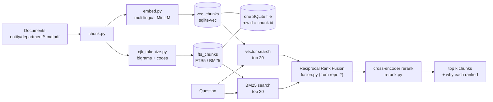

# hybrid-search-rag

[](https://github.com/wchklaus97/hybrid-search-rag/actions/workflows/tests.yml)

**Theme: hybrid search for Hong Kong code-mixed documents. Keyword search (BM25) and vector search run together in one SQLite file, and a multilingual cross-encoder reranks the results.**

Hong Kong business text mixes Chinese and English in the same sentence ("如懷疑資料外洩，須喺 24 小時內通知 Compliance Officer"). It is also full of codes and amounts (`FIN-07`, `HKD 5,000`, `RMB 50,000`). Vector search is good at meaning but blurs exact terms. Keyword search is exact but, out of the box, cannot see Chinese words at all. This repo combines the two and measures what each one adds.

> The corpus is the **fictional** Harbour Lane Group (Hong Kong head office and a Shenzhen subsidiary) used across this series, plus six fictional *distractor* documents. Nothing here is legal or HR advice.

## What you will learn

1. **Why keyword search fails on Chinese out of the box, and the fix.** SQLite FTS5 makes a whole clause one token, so searching 外洩 ("leak") finds nothing. Character bigrams fix that without a dictionary.
2. **BM25 vs vectors.** Which questions each one wins, measured on the same evidence-based eval as [local-rag-sqlite](https://github.com/wchklaus97/local-rag-sqlite).
3. **Hybrid fusion (RRF) and cross-encoder reranking.** Why you retrieve cheaply first, then rerank a small pool with a model that reads the query and the passage together.
4. **Query replay.** Re-run the exact queries a real agent sent (recorded in [agent-rag-pydantic-ai](https://github.com/wchklaus97/agent-rag-pydantic-ai)) to test a new retriever with no LLM cost.
5. **Contracts between repos.** This retriever plugs into repo 3's agent through its `Searcher` contract, and fusion reuses repo 2's lift-out `fusion.py`.

## The part you can lift out

[`src/hybridrag/cjk_tokenize.py`](src/hybridrag/cjk_tokenize.py) is a dependency-free tokenizer that makes any keyword engine (SQLite FTS5, a hand-rolled BM25, Whoosh, …) work on mixed Chinese/English text:

- CJK runs become bigrams: `資料外洩 → 資料 料外 外洩`
- amounts are normalised: `HKD 5,000 → hkd 5000`
- codes keep their shape and their parts: `FIN-07 → fin-07 fin 07`
- full-width forms are normalised

Copy the one file; a test guards that it imports nothing from this package.



## Quickstart

```bash
git clone https://github.com/wchklaus97/hybrid-search-rag.git && cd hybrid-search-rag
uv sync --extra local                       # multilingual embedder + cross-encoder (~1 GB of models on first use)
uv run hrag index build examples/harbour-lane
uv run hrag search "How quickly must a suspected customer data leak be reported?"
```

`hrag search` runs every mode and shows **why** each chunk ranked where it did, for example `vector #7 0.412  keyword #1 9.310  rerank #1 6.877`. Without `--extra local`, the `hash` embedder still works with `RERANKER=none`.

## Results (details in [eval/RESULTS.md](eval/RESULTS.md))

**The question this repo was built for:** repo 3's agent missed *"How quickly must a suspected customer data leak be reported?"*. The answer is in a Chinese sentence: 如懷疑資料外洩，須喺 24 小時內通知 Compliance Officer. Replaying the agent's 10 recorded queries with a realistic candidate pool (5 per retriever):

| | vector | BM25 | hybrid | vector + rerank | **hybrid + rerank** |
|---|---|---|---|---|---|
| `leak-en`: queries that found the answer | 0/10 | 4/10 | 2/10 | 0/10 | **4/10** |
| all replayed agent queries | 0.69 | 0.86 | 0.80 | 0.71 | **0.88** |

**A real but partial fix.** A reranker can't rescue a chunk that was never retrieved (vector + rerank: 0/10). BM25 brings the answer into the pool, but only for the 4 queries containing "customer", a word that happens to sit in a neighbouring English sentence. Queries using "breach" or "notification" share no words with the Chinese text. The robust fix is cross-lingual query expansion.

Other measured lessons (full corpus with distractors, chunk 200, pool 5):

| | vector | BM25 | hybrid | **hybrid + rerank** |
|---|---|---|---|---|
| repo 1's 25 questions, hit@3 | 0.72 | 0.60 | 0.84 | **0.88** (MRR 0.82) |
| …English questions | 0.82 | 0.47 | 0.82 | 0.88 |
| …Chinese questions | 0.50 | 0.88 | 0.88 | 0.88 |
| 10 exact-term questions (FIN-07, HKD 5,000…), hit@1 | 0.70 | **1.00** | 0.80 | 1.00 |

- Vectors and BM25 fail on opposite questions, and hybrid gets both.
- Fusion can also drag a strong retriever down.
- A candidate pool as big as the corpus makes any reranker look perfect.
- Colloquial abbreviations (專票 for 增值稅專用發票) defeat both retrievers.
- In a live run of repo 3's agent, hybrid + rerank removed every retrieval failure and needed fewer searches. The overall pass rate (0.97 vs 0.94) is within run-to-run noise.

## Commands

| Command | What it does |
|---|---|
| `hrag index build <folder>...` | Ingest → chunk → embed → SQLite with both a vector index and an FTS5 keyword index |
| `hrag search "<q>" [--mode all\|vector\|keyword\|hybrid\|vector+rerank\|hybrid+rerank]` | Search and print per-stage ranks and scores |
| `hrag eval [--qa F] [--corpus base,full] [--embed hash,local] [--sizes 200,400]` | Evidence-based hit@1 / hit@k / MRR for every mode |
| `hrag replay [--corpus base] [--embed local] [--chunk-size 200]` | Re-run the queries repo 3's agent actually sent, against every mode |
| `hrag agent-eval [--modes vector,hybrid+rerank]` | Repo 3's agent and eval, with this repo's search behind the tool (`--extra agent`, needs an LLM key) |

Config lives in `hrag.toml`. Env overrides: `RAG_DB`, `EMBED_PROVIDER`, `EMBED_MODEL`, `SEARCH_MODE`, `RERANKER`, `RERANKER_MODEL`.

## Series

Four small open-source demos built around one fictional Hong Kong company. Each has one theme and one module you can lift out:

| Repo | Theme | Lift-out module |
|---|---|---|
| [local-rag-sqlite](https://github.com/wchklaus97/local-rag-sqlite) | Classic RAG pipeline, chunking first | `chunk.py` |
| [multimodal-page-rag](https://github.com/wchklaus97/multimodal-page-rag) | Page-level units + late fusion | `fusion.py` |
| [agent-rag-pydantic-ai](https://github.com/wchklaus97/agent-rag-pydantic-ai) | Retrieval as an agent tool | `tools.py` |
| **hybrid-search-rag** | Hybrid BM25 + vector + rerank for code-mixed text | `cjk_tokenize.py` |

## Contributing

Good first issues:
- an LLM listwise reranker to compare with the cross-encoder
- query translation (zh ⇄ en) before search
- a bigger corpus so the candidate pool is a real subset
- BM25 parameter tuning (FTS5 fixes k1=1.2, b=0.75)

Keep `cjk_tokenize.py` dependency-free. MIT licensed.

## License

MIT
